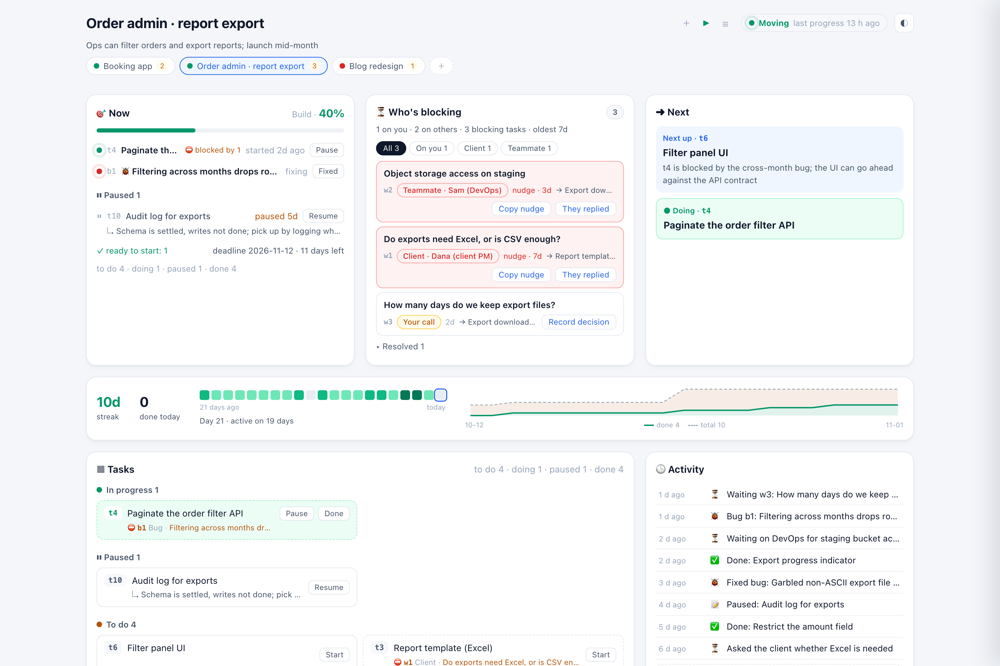
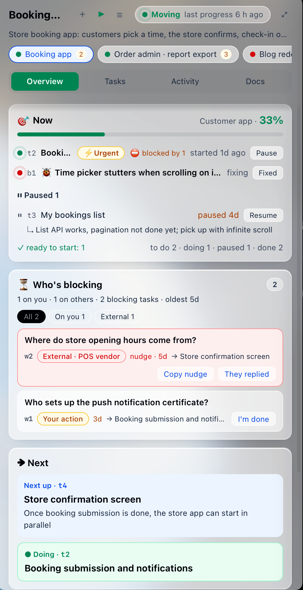

<p>
  <picture>
    <source media="(prefers-color-scheme: dark)" srcset="assets/logo-white.svg">
    
  </picture>
</p>

# Forthmark

**English** · [中文](README.zh-CN.md)

> **Forthmark is a project layer above your coding agents. Agents jot down conclusions as they work, so you can see where every project stands, who it's blocked on and what's next — without opening a session or digging through docs — and handle what's waiting on you right from the panel. Sessions and execution stay with your own agent.**

Full introduction (summary, design principles, features, non-goals, who it's for): [docs/introduction.md](docs/introduction.md)

> **Early preview (v0.1):** **macOS + Claude Code (CLI)**, in English and Chinese. A Windows preview with a tray app is available. See [Scope and limits](#scope-and-limits).

- Your project's markdown stays the agent's working material; the agent additionally keeps a **status written for humans**: progress, next step, waiting items, bugs, decisions, timeline.
- **Zero intrusion:** nothing is written into your projects and their git is only read (`git status` / `git log`). All data lives in `~/.forthmark/`.
- Your own agent does the work; Forthmark never calls an LLM.




## Principle

Helpful, but restrained. The agent only ever gets two things from us: **your own words** and **the project's factual state**. We don't give instructions on your behalf and don't repeat what it already knows (resuming a session injects nothing). Choosing, naming and listing sessions belongs to the agent; the panel only offers shortcuts to the agent's own commands.

## What it solves

Common pains when you push real work forward with agents — especially projects with clients and other people involved:

| Pain | Without it | With Forthmark |
|---|---|---|
| **You have to open a session to ask "where are we?"** | The agent rereads the markdown and git log: tens of thousands of tokens, plus waiting | The agent notes progress as it works (one command, a few hundred tokens); you open the panel: no tokens, no waiting |
| **Markdown piles up and the big picture gets lost** | PLAN / TODO / PROGRESS / specs scattered around; which ones still matter? | The Docs tab groups files by purpose, pins progress sources, and flags files changed since you last looked |
| **Blocked on someone, then forgotten** | Waiting on a client, a teammate's permission, or your own call — buried in docs and chats until things quietly stop | "Who's blocking" groups items by who you're waiting on, shows how long and which tasks they block; after 3 days it suggests a nudge with a ready-to-send message; the status line always shows "⏳ N waiting on you"; overdue items trigger a notification |
| **Interrupted, and never coming back** | Something urgent cuts in, the original task gets buried, and days later you can't remember where it stood | The original task is **paused with a resume note**; the urgent one is marked as such; when it's done, "next" points back to the paused task |
| **"Marked done" but not actually done** | The status says done, reality disagrees, and later work breaks | Items that files can confirm carry a read-only check (`exists` / `missing` / `contains`): "I'm done" verifies first, and items resolve themselves once the check passes |
| **You answered in the panel, the session doesn't know** | You decided something elsewhere and have to repeat it in the session | Decisions, "done" and "they replied" from the panel reach the running session with your next message |
| **An idea, but starting is too much friction** | Open a terminal, make a folder, cd, start the agent, explain the idea, set up tracking | Panel "＋": a name and an optional one-line goal → folder created, tracked, and your agent opened in a terminal, ready for your first message |
| **Re-explaining context in every new session** | A fresh session has to be told where the project stands and what's pending | Each new session receives the rules and current status automatically |
| **Decisions and history are hard to find** | Why was it decided that way? What happened with that bug? Search the chat logs | Resolved waits (question → answer), closed bugs and decisions are all browsable in the panel |

### Why it's worth it

**One fewer "where are we?" pays for many status updates.** A question costs tens of thousands of tokens plus waiting; a status update is one command and a few hundred tokens. Interruptions work the same way: **one resume note replaces a full context rebuild when you come back.** And that's before counting your own time and attention.

The tool's own overhead is visible too: the panel shows "tool overhead N+" — N is the exact number of extra turns caused by a hook asking the agent to catch up, `+` is the rules injected at session start and the routine recording commands (small, not counted). Measured on a real project: onboarding plus initialization was about 0.5% of the session; in untracked projects the hooks add about 0.16 s and zero tokens. The panel, reminders and statistics are all computed locally — no model calls.

## Install

Requires macOS, Python 3.9+ (the system one is fine) and Claude Code; the menu bar app needs the Xcode command line tools (`xcode-select --install`).

```bash
git clone https://github.com/Cat0513/forthmark.git && cd forthmark
./install.sh                  # hooks + status line + /forthmark commands + menu bar app
./install.sh --no-app         # skip the menu bar app; use the browser panel (python3 tools/forthmark.py open)
./install.sh --no-statusline  # leave Claude Code's status line alone
./install.sh --uninstall      # undo everything (status data in ~/.forthmark is kept)
```

The kit can live anywhere (spaces in the path are fine). Hooks, rules and the menu bar app remember where it is, so **re-run `./install.sh` after moving the kit**.

Install backs up `~/.claude/settings.json` first, then adds:

| Change | Purpose |
|---|---|
| Global SessionStart hook | In tracked projects, gives the agent the recording rules and current status when a session starts |
| Global UserPromptSubmit hook | When you send a message, passes on what you did in the panel since (decisions, items marked done…); outputs nothing — zero tokens — when there's nothing new |
| Global Stop hook | After each turn, checks the status is up to date and valid, then refreshes the panel |
| Read/write access to `~/.forthmark` | So the agent doesn't ask for permission on every update |
| Claude Code status line | One line at the bottom of the terminal: `🎯 t2 协议页 · ⏳ 9 等你 最久 6 天 · ⏸ 1 · 38%` — current task, 9 items waiting on you (oldest 6 days), 1 paused, 38% done (shown to you only, never sent to the model; an existing status line is kept and shown first; skip with `--no-statusline`) |
| `/forthmark` `/forthmark-add` `/forthmark-remove` | User-level slash commands |

In untracked projects the hooks check the registry and exit without doing anything.

To install or remove parts separately: `python3 tools/forthmark.py setup` / `teardown`, `zsh tools/build_app.sh --install`.

## Install on Windows (preview)

Requires Windows 10/11 (64-bit), Git and Claude Code. Python is bundled and administrator rights aren't needed.

1. Download `Forthmark-Setup-*.exe` from [Releases](https://github.com/Cat0513/forthmark/releases/latest) and run it.
2. The installer isn't code-signed yet, so Windows SmartScreen may warn you: choose **More info**, then **Run anyway**.
3. Forthmark connects to Claude Code on first launch and opens the panel. If you don't see its tray icon, look under `^` in the taskbar. Left-click opens the panel, right-click the menu (launch at login, test notification, quit).

Uninstall it from Windows Settings → Apps: the hooks come out of Claude Code, and your status data in `~\.forthmark` is kept.

Prefer the command line? You'll need Python 3.9+ ([python.org](https://www.python.org/downloads/windows/), with "Add python.exe to PATH" ticked). This gives you recording and the browser panel, without the tray app or notifications:

```powershell
git clone https://github.com/Cat0513/forthmark.git; cd forthmark
powershell -ExecutionPolicy Bypass -File .\install.ps1                # hooks + status line + /forthmark commands
powershell -ExecutionPolicy Bypass -File .\install.ps1 -NoStatusline  # leave Claude Code's status line alone
powershell -ExecutionPolicy Bypass -File .\install.ps1 -Uninstall     # undo everything (status data in ~\.forthmark is kept)
python tools\forthmark.py open                                        # open the panel in your browser
```

Sessions open in Windows Terminal or PowerShell.

## Menu bar app (recommended)



```bash
zsh tools/build_app.sh --install   # included in install.sh; re-run after updating the kit
```

- The menu bar shows a summary (`⏳9` waiting on you, `📣` time to nudge, `⏸` stalled); hover for per-project details.
- **Click**: a compact popover to glance and act; its expand button opens the panel window; documents open in their own window.
- **⌥-click**: open the panel window directly.
- **Right-click**: panel window (native, wide layout; appears in the Dock and Cmd-Tab while open), open in browser, refresh, **launch at login**, test notification, quit.
- Starts the local service for you — no need to run `forthmark.py open`.
- Notifications come from "Forthmark" (permission is asked the first time); clicking one opens the panel.
- The native app is only a shell: the interface, data and actions are the same as in the browser.

## Try it first

Not ready to track a real project? Generate a few fictional demo projects in a separate data directory (your real data and Claude settings are untouched):

```bash
python3 tools/demo.py --lang=en             # built in ~/.forthmark-demo (--lang=zh for Chinese)
FORTHMARK_HOME=~/.forthmark-demo/data python3 tools/forthmark.py open
```

## Usage

| To… | Do this |
|---|---|
| Track a project | Open Claude Code in it and type `/forthmark-add` (the agent initializes the status from existing docs) |
| The project folder was renamed or moved | `python3 tools/forthmark.py move OLD_PATH NEW_PATH` (status, history and doc notes are kept) |
| See progress and act from the panel | `python3 tools/forthmark.py open`: starts the local service (127.0.0.1 only) and opens the panel; buttons write to the status directly |
| Look without acting | Open `~/.forthmark/panel.html` in a browser (static, refreshed every turn), or type `/forthmark` |
| Start a new project | "＋" in the panel's project bar, or `forthmark.py new NAME --goal="…"` |
| Open the agent in this project | Three shortcuts at the top of the panel, all the agent's own features — we only type the command in the project folder for you:<br>**＋** new session (`claude`, receives the project status) · **▶** most recent session (`claude --continue`) · **☰** the agent's own session picker (`claude --resume`)<br>CLI: `forthmark.py session` / `continue` / `sessions` |
| Get interrupted | Tell the agent "handle X first", or just start the new work — the agent pauses the original task with a resume note; or use Pause / Resume in the panel |
| Stop tracking | `/forthmark-remove` (data is kept; you can track it again any time) |
| See how reliably the agent records, and the tool's overhead | `python3 tools/forthmark.py stats` |
| Updated the kit's code | `forthmark.py stop`, then `forthmark.py open` (hooks pick up changes immediately; the long-running service needs a restart) |
| Reminders | The menu bar app checks every 30 minutes (9:00–21:00): waiting on others > 3 days, waiting on you > 3 days, paused > 3 days, in progress with no change for 3 days → one notification per project, each item at most once a day. Preview with `forthmark.py notify --dry-run` |
| Check the panel isn't broken | `python3 tools/forthmark.py check` (headless Chrome loads every tab of every project; fails on JS errors or blank pages) |

### Panel

- **Now**: tasks in progress (urgent ones marked ⚡), paused tasks (for how long, resume note, Resume); tasks unchanged for days are flagged as possibly stalled.
- **Who's blocking**: grouped by waiting on your decision / your action / client / teammate / external, sorted by how many tasks each unblocks; red is reserved for others you should nudge.
- **Next**, **Cadence** (streak, last 21 days of activity, burn-up curve), **Tasks** (blocked ones show what blocks them, one click away), **Activity** (changes since you last looked are marked new), **Bugs**, **Docs**.
- Narrow windows use tabs (Overview / Tasks / Activity / Docs), wide windows a dashboard; switch projects at the top; light and dark themes.
- Opened through the local service, "Record decision", "I'm done", "They replied", task Start / Pause / Resume / Done and bug "Fixed" write to the status directly (validation, timeline and atomic writes are handled by the tool, no LLM involved), and the page updates in place without jumping. In the static page these buttons fall back to copying a sentence for your agent.

### Docs

The Docs tab lists the project's markdown files and scripts (tracked by git or not ignored; read-only; `.env`, `node_modules` etc. never appear).

- **Progress sources**: the agent's PROGRESS / TODO files are pinned on top with their checkbox progress, flagged when newer than the status, and the agent is reminded to reconcile them at session start.
- **Purpose**: the agent records what each doc is for with `forthmark.py doc <path> role=… purpose=…` (done once during `/forthmark-add`).
- **Your notes**: tags, notes, pin, hide — stored in `~/.forthmark/projects/<project>/docs.json`, never in project files.
- **Updated**: docs changed since you last viewed them are flagged.
- **Preview**: in a side panel (bundled marked + DOMPurify + github-markdown-css, works offline; needs the panel opened via `forthmark.py open`), or open in the default app.

### Architecture

```
Core operations (forthmark.py: add_task / pause_task / add_waiting / resolve_waiting / set_bug …, one place for validation and atomic writes)
 ├─ CLI `op`          ← agents (following the injected rules), scripts
 ├─ local HTTP service ← panel buttons (you)
 ├─ hooks             ← session start injection / end-of-turn checks, overhead accounting
 └─ MCP (planned)     ← agents without hooks, such as Codex and Cursor
all reading and writing the same ~/.forthmark/projects/<project>/status.json
```

## What's in the box

| File | Purpose |
|---|---|
| `tools/forthmark.py` | CLI: setup / teardown / add / remove / move / list / prune / rules / validate / show / stats / html / open / serve / stop / op / docs / doc / check / new / session / continue / sessions. Agents update the status with `op` (add_task, set_task, pause_task, resume_task, add_waiting, resolve_waiting, add_bug, set_bug, add_decision, set_next, set_milestone, set_project, note) instead of reading the whole file |
| `hooks/session_start.py` | Global SessionStart hook: injects rules and current status; reminds the agent when progress sources are newer than the status |
| `hooks/prompt_submit.py` | Global UserPromptSubmit hook: passes your panel actions to the running session |
| `hooks/stop_check.py` | Global Stop hook: staleness and format checks, panel refresh, compliance log and overhead accounting |
| `hooks/statusline.py` | Claude Code status line |
| `app/Forthmark.swift`, `tools/build_app.sh` | Menu bar app (native shell: summary, popover, notifications, launch at login) |
| `templates/RULES.md` | Recording rules for the agent |
| `templates/panel.html` | Panel template |
| `schema/status.schema.json` | Status format |
| `commands/` | Slash command templates |
| `tools/demo.py` | Fictional demo projects |
| `assets/` | Logo and app icon sources (`tools/make_icon.sh` rebuilds the icon) |
| `vendor/` | marked (MIT), DOMPurify (Apache-2.0 / MPL-2.0), github-markdown-css (MIT) for previews and morphdom (MIT) for in-place updates, with their licenses |

## Configuration

`~/.forthmark/config.json` (defaults apply when absent):

```jsonc
{
  "terminal": "auto",                  // auto (Ghostty if installed, else Terminal) | ghostty | terminal
  "agent": "claude",                   // ＋ new session (it starts empty: the first message is yours). Codex: "codex"
  "resume_last": "claude --continue",  // ▶ most recent session. Codex: "codex resume --last"
  "resume_pick": "claude --resume",    // ☰ session picker. Codex: "codex resume"
  "projects_dir": "~/Documents",       // where new projects go
  "git_init": true,                    // git init new project folders
  "lang": "auto"                       // auto (follows the macOS language) | en | zh
}
```

After changing `lang`, re-run `./install.sh` so the slash commands follow, and restart the menu bar app.

Command-line agents (Claude Code, Codex CLI, …) are supported; GUI clients may later be supported by opening the folder and copying an opening message.

## Data directory

```
~/.forthmark/
  registry.json                   tracked projects (by path)
  projects/<project>/status.json  the status (the "live file" agents read and write; kept small)
  projects/<project>/archive.json older done tasks, resolved waits, closed bugs, old decisions and activity
                                  (archived automatically above 12 KB; the panel and /forthmark always see the merged data)
  projects/<project>/docs.json    doc tags, notes and purposes (an overlay)
  projects/<project>/history.jsonl daily progress snapshots (for the burn-up curve)
  projects/<project>/hook-log.jsonl compliance log
  projects/<project>/usage.json   tool overhead
  projects/<project>/sync.json    what each session has already been told (panel updates are passed on once)
  notify.json                     what was already notified today
  config.json                     settings (terminal, agent, new project folder)
  launch/                         temporary scripts for opening terminals (cleaned up after a day)
  panel.html                      static panel
```

## Scope and limits

| | Status |
|---|---|
| macOS 13+, Python 3.9+ | ✅ Supported (tested on Intel; Apple Silicon should work — feedback welcome) |
| Claude Code CLI | ✅ Full support: recording, hook checks, panel → session sync, status line |
| Claude desktop app, Code tab | ❓ Should share the hooks in `~/.claude`; not verified yet |
| Codex CLI / Cursor etc. | ⚠️ Only the "new project / open session" shortcuts (commands are configurable); no hooks, so recording waits for the MCP entry point |
| Terminals | Ghostty, macOS Terminal; more later |
| Language | English and Chinese, following the macOS language (`lang` in config.json to override). What agents record is in your own language |
| Windows 10/11 | 🧪 Preview: installer with bundled Python, tray app, panel windows, notifications, launch at login, recording, hooks and status line; the installer isn't code-signed yet |
| Linux | The core (hooks, panel, status line) likely works; no menu bar app or terminal launching; untested |

Other limits:

- Overhead accounting is exact only for extra turns caused by the hooks; it reads Claude Code's internal transcript format and pauses (without affecting anything else) if that format changes.
- This is an early version of a personal project: the status format may still change, with migrations provided when it does.

## Security

- The local service listens on `127.0.0.1` only and answers only requests addressed to `127.0.0.1` / `localhost` (DNS rebinding protection); writes also require the page's random token and reject cross-site origins. `server.json`, which holds the token, is readable only by you.
- `~/.forthmark` is mode 700.
- Opening a terminal types nothing on your behalf: the agent starts empty and paths are quoted.
- Doc previews read only whitelisted file types inside the project; markdown is sanitized with DOMPurify; the menu bar app hands only http / https / mailto links to the browser.
- Hook failures exit silently and never interrupt your session; a turn is blocked at most once.
- Please report security issues privately via GitHub's private vulnerability reporting (Security → Report a vulnerability), not in public issues.

## License

The code is MIT licensed — see [LICENSE](LICENSE). The bundled third-party libraries (marked, DOMPurify, github-markdown-css, morphdom) keep their own licenses — see [vendor/THIRD_PARTY.md](vendor/THIRD_PARTY.md).

The Forthmark name and logo (the marks in `assets/`) are not covered by the MIT license: you may use them to refer to this project, but not in a way that suggests an official release, endorsement or affiliation.
