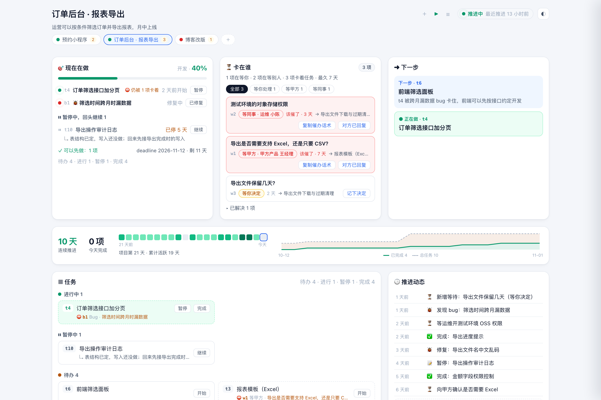
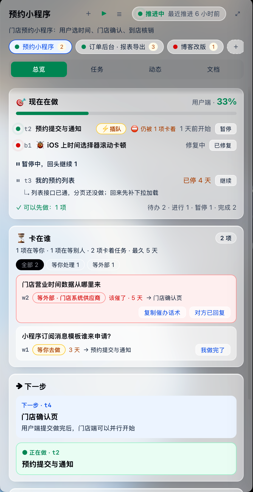

<p>
  <picture>
    <source media="(prefers-color-scheme: dark)" srcset="assets/logo-white.svg">
    
  </picture>
</p>

# Forthmark

[English](README.md) · **中文**

> **Forthmark 是架在 agent 之上的"项目层"：agent 干活时顺手记下结论，你不用开会话、不用翻文档，就能一眼看清每个项目做到哪、卡在谁、下一步，并且能在面板上把等你处理的事直接处理掉。会话和执行本身，全部交给你自己的 agent。**

完整介绍（总结、分点、设计理念、功能清单、不做什么、适合谁）：[docs/introduction.zh-CN.md](docs/introduction.zh-CN.md)

> **早期预览（v0.1）**：支持 **macOS + Claude Code（命令行）**，中英文界面。Windows 预览版已可用（含托盘应用）。详见文末「支持范围与限制」。

- 项目里的 md 照常给 agent 用；agent 额外维护一份**给人看的状态**（进度、下一步、等待项、bug、决策、时间线）。
- **零侵入**：不往项目里写任何文件，不碰项目的 git（只读 `git status` / `git log`）。所有数据在 `~/.forthmark/`。
- 执行还是你自己的 agent；本工具不调用任何 LLM。




## 原则

辅助，但克制。只交给 agent 两样东西：**你自己说的话**和**项目的事实状态**；不替你下指令，不重复给它已经知道的东西
（例如接回旧会话时不再注入）。会话的选择、命名、列表都交给 agent 自己，面板只提供快捷入口。执行永远是你自己的 agent，本工具不调用 LLM。

## 解决什么问题

用 agent 推进真实工作（尤其有甲方、上下游的项目）时，常见的几种难受：

| 痛点 | 没有这个工具时 | 有了之后 |
|---|---|---|
| **想知道进度得开会话问** | 问 agent「做到哪了」，它重读 md 和 git log，一次几万 token，还要等 | agent 干活时顺手记一笔（一条命令，几百 token）；你打开面板就看到，不花 token、不用等 |
| **md 越写越多，看不清全局** | PLAN / TODO / PROGRESS / 需求散在仓库里，不知道哪份还有用 | 面板「文档」页按作用分组，进度来源置顶，看过之后又改了会标「有更新」 |
| **卡在等人，然后忘了** | 等甲方确认、等同事开权限、等自己拍板——埋在文档和聊天里，等着等着就停了 | 「卡在谁」按等谁分组、显示等了几天、阻塞了哪些任务；等别人超过 3 天提示该催，催办话术一键复制；终端状态栏常驻「⏳ N 等你」，超期还会弹系统通知 |
| **被打断，回不来** | 做到一半插进来别的事，原来那件被挤下去，过几天想不起做到哪，只能重新摸索 | 原任务**暂停并写下恢复要点**，新事标「插队」；插队完成后下一步自动指回原任务；「现在在做」里能看到暂停了几天 |
| **点了「我做完了」其实没做** | 状态说做完了，实际没做，后面的事跟着出错 | 能从文件判断的事项带一个只读核实条件（`exists` / `missing` / `contains`）：点「我做完了」先核实；做完后自动标完成，不用点 |
| **在面板上回答了，会话却不知道** | 在别处给了答复，还得回到会话里再说一遍 | 面板上「记下决定 / 我做完了 / 对方已回复」后，你下一次在会话里发消息，agent 就会收到这些更新 |
| **想到一个点子，开工成本太高** | 开终端、建文件夹、cd、启动 agent、交代想法、再接入跟踪 | 面板「＋」：名字，加一句可选的目标 → 建文件夹、接入跟踪、在终端里打开 agent，第一句话由你来说 |
| **回来时要重新交代背景** | 新开会话得重新跟 agent 解释项目在哪、在等什么 | 会话开始时自动把规则和当前状态交给 agent，开场就知道做到哪 |
| **决定和历史找不到** | 当时为什么这么定、那个 bug 怎么回事，要翻聊天记录 | 已解决的等待项（问题 → 答复）、已关闭的 bug、决策都能在面板上回看 |

### 为什么值得

**少问一次「做到哪了」，就抵得上很多次状态更新。** 一次提问是几万 token 加上等待；一次记录是一条命令、几百 token。
被打断时也一样：**写一句恢复要点，换掉回来时一次完整的上下文重建。** 还没算上你自己省下的时间和注意力。

工具自己的开销也看得见：面板顶部显示「工具开销 N+」——N 是因为 hook 拦下 agent 补记而多出的轮次（精确），
`+` 是会话开始注入的规则和日常记录命令（很小，未计入）。实测：一个真实项目的接入加初始化约占会话的 0.5%；
未接入的项目里 hook 只多约 0.16 秒、零 token。面板、提醒、统计全部是本地计算，不调用模型。

## 安装

需要：macOS、Python 3.9+（系统自带的即可）、Claude Code；菜单栏应用需要 Xcode 命令行工具（`xcode-select --install`）。

```bash
git clone https://github.com/Cat0513/forthmark.git && cd forthmark
./install.sh                  # hook + 状态栏 + /forthmark 命令 + 菜单栏应用
./install.sh --no-app         # 不装菜单栏应用，用浏览器面板（python3 tools/forthmark.py open）
./install.sh --no-statusline  # 不动 Claude Code 的状态栏
./install.sh --uninstall      # 全部撤销（~/.forthmark 里的状态数据保留）
```

工具目录放在哪都行（路径里有空格也可以）。hook、规则和菜单栏应用会记下它的位置，**移动了工具目录后重新运行一次 `./install.sh`**。

安装会先备份 `~/.claude/settings.json`，然后：

| 改动 | 作用 |
|---|---|
| 全局 SessionStart hook | 在已接入的项目里开会话时，把记录规则和当前进度注入给 agent（自动恢复上下文） |
| 全局 UserPromptSubmit hook | 你每次发消息时，如果你在面板上记过决定、标过完成等，把这些更新告诉正在进行的会话（没有更新就什么都不输出，零 token） |
| 全局 Stop hook | 每轮结束检查状态有没有更新、格式对不对，并刷新面板 |
| 允许读写 `~/.forthmark` | agent 更新状态时不用每次确认 |
| Claude Code 状态栏 | 终端底部常驻一行：`🎯 t2 协议页 · ⏳ 9 等你 最久 6 天 · ⏸ 1 · 38%`（只显示给你，不进模型，零 token；已有状态栏会保留并排在前面；`--no-statusline` 可跳过） |
| `/forthmark` `/forthmark-add` `/forthmark-remove` | 用户级斜杠命令 |

未接入的项目里，这几个 hook 查一下登记表就退出，不做任何事。

单独装或卸载其中一部分：`python3 tools/forthmark.py setup` / `teardown`、`zsh tools/build_app.sh --install`。

## 在 Windows 上安装（预览版）

需要 Windows 10/11（64 位）、Git 和 Claude Code。已内置 Python，不需要管理员权限。

1. 从 [Releases](https://github.com/Cat0513/forthmark/releases/latest) 下载 `Forthmark-Setup-*.exe` 并运行。
2. 安装包暂未做代码签名，Windows SmartScreen 可能会提示风险：点“更多信息”，再点“仍要运行”。
3. 首次启动会自动接入 Claude Code 并打开面板。如果看不到托盘图标，到任务栏的 `^` 里找。左键打开面板，右键打开菜单（开机自启、测试通知、退出）。可以直接在面板上新建项目或接入已有文件夹。

在 Windows“设置 → 应用”里卸载：会从 Claude Code 中移除 hook，`~\.forthmark` 里的状态数据会保留。

想用命令行安装的话，需要 Python 3.9+（从 [python.org](https://www.python.org/downloads/windows/) 安装，并勾选 Add python.exe to PATH）。这种方式有记录功能和浏览器面板，没有托盘应用和通知：

```powershell
git clone https://github.com/Cat0513/forthmark.git; cd forthmark
powershell -ExecutionPolicy Bypass -File .\install.ps1                # hook、状态栏和 /forthmark 命令
powershell -ExecutionPolicy Bypass -File .\install.ps1 -NoStatusline  # 不改动 Claude Code 的状态栏
powershell -ExecutionPolicy Bypass -File .\install.ps1 -Uninstall     # 撤销全部改动（~\.forthmark 里的状态数据会保留）
python tools\forthmark.py open                                        # 在浏览器打开面板
```

会话在 Windows Terminal 或 PowerShell 中打开。

## 菜单栏应用（推荐）



```bash
zsh tools/build_app.sh --install   # install.sh 已包含；更新工具后重新编译用这一行
```

- 菜单栏显示汇总（`⏳9` 等你、`📣` 该催、`⏸` 停滞），悬停看各项目情况。
- **左键**：小窗（HUD），瞄一眼、点按钮；小窗右上角的「展开」按钮打开面板窗口；在小窗里点文档会**弹出独立窗口**完整展示。
- **⌥ + 左键**：直接打开面板窗口。
- **右键**：**打开面板窗口**（原生大窗口，宽屏布局；开着时出现在 Dock 和 Cmd-Tab 里，全部关掉后回到只在菜单栏）、在浏览器打开、刷新、**开机自启**、发送测试通知、退出。
- 自动拉起本地服务，不用再手动 `forthmark.py open`。
- 通知以「Forthmark」的名义发出（第一次会请求权限），点通知打开面板。
- 原生外壳只是一层壳：界面、数据、操作都是同一套，更新工具后重新运行上面的命令即可。

## 先看看效果

不想先接入自己的项目，可以生成一组虚构的演示项目（独立的数据目录，不碰你的真实数据和 Claude 配置）：

```bash
python3 tools/demo.py                       # 建在 ~/.forthmark-demo（--lang=en 生成英文版）
FORTHMARK_HOME=~/.forthmark-demo/data python3 tools/forthmark.py open
```

## 使用

| 想做什么 | 怎么做 |
|---|---|
| 接入一个项目 | 在项目里打开 Claude Code，输入 `/forthmark-add`（agent 会根据现有文档初始化状态） |
| 项目文件夹改名 / 移动了 | `python3 tools/forthmark.py move 旧路径 新路径`（状态、历史、文档备注都保留） |
| 看进度并在面板上操作 | `python3 tools/forthmark.py open`：启动本地服务（仅 127.0.0.1）并打开面板，按钮直接写入状态 |
| 只看不操作 | 浏览器打开 `~/.forthmark/panel.html`（静态页，每轮自动更新），或输入 `/forthmark` |
| 新开一个项目 | 面板项目栏的「＋」，或 `forthmark.py new 名字 --goal="…"` |
| 打开这个项目的 agent | 面板顶部三个快捷按钮，用的都是 agent 自己的功能，我们只替你在项目目录里敲命令：<br>**＋** 新会话（`claude`，会拿到项目状态）· **▶ 继续** 最近的会话（`claude --continue`）· **☰** agent 自己的会话列表（`claude --resume`）<br>命令行：`forthmark.py session` / `continue` / `sessions` |
| 被打断，先做别的 | 直接跟 agent 说「先处理 X」，或者直接开始新工作——agent 会暂停原任务并写恢复要点；也可以在面板上点「暂停」/「继续」 |
| 停止跟踪 | `/forthmark-remove`（数据保留，可随时再接入） |
| 看 agent 守约率和工具开销 | `python3 tools/forthmark.py stats` |
| 更新了工具代码 | `forthmark.py stop` 再 `forthmark.py open`（hook 立即生效，常驻服务需要重启） |
| 提醒 | 菜单栏应用每 30 分钟检查一次（9–21 点）：等别人超过 3 天、等你的事最久超过 3 天、暂停超过 3 天、进行中 3 天没变化 → 系统通知，每个项目一条、同一件事一天一次。`forthmark.py notify --dry-run` 预览 |
| 检查面板有没有坏 | `python3 tools/forthmark.py check`（无头 Chrome 打开每个项目的每个标签页，有 JS 报错或空白页就失败） |

### 面板

- **现在在做**：正在做的任务（插队的标 ⚡），暂停中的任务（停了几天、恢复要点、「继续」）；进行好几天没变化的会提示「可能已搁置」。
- **卡在谁**：按 等你决定 / 等你去做 / 等甲方 / 等同事 / 等外部 分组，按能解锁多少任务排序；红色只用于等别人且该催的。
- **下一步**、**推进节奏**（连续天数、最近 21 天活跃、进度曲线）、**任务**（被卡住的直接显示卡在什么，点一下跳过去）、**推进动态**（你不在时的变化标「新」）、**Bug**、**文档**。
- 窄窗口是贴片（总览 / 任务 / 动态 / 文档），宽窗口是大屏；多个项目在顶部切换；深浅色可切换。
- 通过本地服务打开时，「记下决定」「我做完了」「对方已回复」、任务「开始 / 暂停 / 继续 / 完成」、bug「已修复」直接写入状态
  （校验、时间线、原子写入由工具完成，不经过 LLM），数据有变化才局部更新、页面不跳；静态页里这些按钮退化为复制一句话给你的 agent。

### 文档

面板的「文档」页列出项目里的 md 和脚本（git 跟踪的 + 未被忽略的，只读；`.env`、`node_modules` 等不会出现）。

- **进度来源**：PROGRESS / TODO 等 agent 的进度记录单独置顶，显示勾选进度；比状态新时标出，会话开始时也会提醒 agent 先对齐。
- **作用说明**：agent 用 `forthmark.py doc <路径> role=… purpose=…` 登记每份文档是干什么的（`/forthmark-add` 时会做一遍）。
- **你的标记**：标签、备注、置顶、隐藏，存在 `~/.forthmark/projects/<项目>/docs.json`，不改项目文件。
- **有更新**：你看过之后又被改过的文档会标出来。
- **预览**：点一下在侧栏里看（内置 marked + DOMPurify + github-markdown-css，离线可用；需通过 `forthmark.py open` 打开面板），或「用默认程序打开」。

### 架构

```
核心操作（forthmark.py：add_task / pause_task / add_waiting / resolve_waiting / set_bug …，统一校验与原子写入）
 ├─ 命令行 op      ← agent（按注入的规则记录）、脚本
 ├─ 本地服务 HTTP  ← 面板按钮（人）
 ├─ hooks          ← 会话开始注入 / 结束检查、开销统计
 └─ MCP（计划中）   ← Codex / Cursor 等没有 hook 的 agent
都读写同一份 ~/.forthmark/projects/<项目>/status.json
```

## 组成

| 文件 | 作用 |
|---|---|
| `tools/forthmark.py` | 命令行：setup / teardown / add / remove / list / prune / rules / validate / show / stats / html / open / serve / stop / op / docs / doc。agent 用 `op` 更新状态（add_task、set_task、pause_task、resume_task、add_waiting、resolve_waiting、add_bug、set_bug、add_decision、set_next、set_milestone、set_project、note），不必读整个状态文件 |
| `hooks/session_start.py` | 全局 SessionStart hook：注入规则与当前状态，进度来源比状态新时提醒对齐 |
| `hooks/prompt_submit.py` | 全局 UserPromptSubmit hook：把你在面板上的更新同步给正在进行的会话 |
| `hooks/statusline.py` | Claude Code 状态栏 |
| `app/Forthmark.swift`、`tools/build_app.sh` | 菜单栏应用（原生外壳：菜单栏汇总、弹出面板、通知、开机自启） |
| `hooks/stop_check.py` | 全局 Stop hook：过期 / 格式检查，刷新面板，记录守约日志和工具开销 |
| `templates/RULES.md` | 给 agent 的记录规则 |
| `templates/panel.html` | 面板模板 |
| `schema/status.schema.json` | 状态格式定义 |
| `commands/` | 斜杠命令模板 |
| `vendor/` | 文档预览用的 marked（MIT）、DOMPurify（Apache-2.0 / MPL-2.0）、github-markdown-css（MIT），面板局部更新用的 morphdom（MIT），附许可证 |

## 配置

面板上的齿轮可以设置终端、Agent（Claude Code 或 Codex）和新项目的位置。其他配置在这个文件里：

`~/.forthmark/config.json`（不存在就用默认值）：

```json
{
  "terminal": "auto",             // auto（装了 Ghostty 就用它，否则用「终端」）| ghostty | terminal
  "agent": "claude",                   // ＋ 新会话（打开时不带任何消息，第一句话由你来说）；Codex: "codex"
  "resume_last": "claude --continue",  // ▶ 最近的会话；Codex: "codex resume --last"
  "resume_pick": "claude --resume",    // ☰ 会话列表；Codex: "codex resume"
  "projects_dir": "~/Documents",  // 新项目默认放这里
  "git_init": true,               // 新项目文件夹是否 git init
  "lang": "auto"                  // auto（跟随 macOS 语言）| zh | en
}
```

改了 `lang` 之后重新运行一次 `./install.sh`（斜杠命令会跟着换语言），并重启菜单栏应用。

目前支持命令行 agent（Claude Code、Codex CLI 等）；图形客户端以后可能用「打开文件夹 + 复制开场白」的方式支持。

## 数据目录

```
~/.forthmark/
  registry.json                  接入了哪些项目（按路径）
  projects/<项目>/status.json    状态（agent 读写的「活文件」，保持精简）
  projects/<项目>/archive.json   归档：较早的已完成任务、已解决等待、已关闭 bug、旧决策和动态
                                 （status.json 超过 12KB 时自动归档；面板和 /forthmark 看到的始终是合并后的完整数据）
  projects/<项目>/docs.json      文档的标签、备注、作用（叠加层）
  projects/<项目>/history.jsonl  每日进度快照（画进度曲线）
  projects/<项目>/hook-log.jsonl 守约日志
  projects/<项目>/usage.json     工具开销统计
  projects/<项目>/sync.json      各会话已同步到的时间点（面板更新只告诉 agent 一次）
  notify.json                    今天已经提醒过的事（避免重复通知）
  config.json                    配置（终端、agent、新项目目录）
  launch/                        拉起终端用的临时脚本（一天后自动清理）
  panel.html                     静态面板
```

## 支持范围与限制

| | 状态 |
|---|---|
| macOS 13+，Python 3.9+ | ✅ 支持（Intel 已实测；Apple Silicon 应可用，欢迎反馈） |
| Claude Code 命令行 | ✅ 完整支持：记录、hook 校验、面板同步回会话、状态栏 |
| Claude 桌面版的 Code 标签 | ❓ 理论上共用 `~/.claude` 的 hook 配置，尚未验证 |
| Codex CLI / Cursor 等 | ⚠️ 只能用「新建项目 / 打开会话」的快捷入口（命令可配置）；没有 hook，状态记录要等 MCP 入口 |
| 终端 | Ghostty、macOS「终端」；其他终端以后再加 |
| Windows 10/11 | 🧪 预览版：内置 Python 的安装包、托盘应用、面板窗口、通知、开机自启、记录、hook 和状态栏；安装包暂未签名 |
| 语言 | 中文、英文，跟随 macOS 系统语言（config.json 的 `lang` 可以强制指定）；agent 记录的内容用你自己的语言 |
| Linux | 核心部分大概率可用（hook、面板、状态栏），菜单栏应用和打开终端不支持，未测试 |

其他限制：

- 工具开销只精确统计 hook 拦截造成的额外轮次；会话记录格式是 Claude Code 内部格式，变化时统计会暂停，不影响其他功能。
- 这是个人项目的早期版本：状态文件格式可能还会变，变化时会提供迁移。

## 安全

- 本地服务只监听 `127.0.0.1`；只接受以 `127.0.0.1` / `localhost` 访问的请求（防 DNS rebinding），写操作还要求页面里的随机令牌、拒绝跨站来源。令牌所在的 `server.json` 只有你能读。
- `~/.forthmark` 权限为 700。
- 打开终端时不会替你输入任何内容，agent 是空白打开的；路径都经过转义。
- 文档预览只读项目内、白名单类型的文件；Markdown 经 DOMPurify 清洗；菜单栏应用里的外部链接只交给浏览器打开 http / https / mailto。
- hook 出错一律静默退出，不会打断你的会话；每轮最多拦一次。
- 发现安全问题请通过 GitHub 的私密漏洞报告（Security → Report a vulnerability）联系，不要公开提 issue。

## 许可证

代码采用 MIT 许可，见 [LICENSE](LICENSE)。面板内置的第三方库（marked、DOMPurify、github-markdown-css、morphdom）各自保留原许可证，见 [vendor/THIRD_PARTY.md](vendor/THIRD_PARTY.md)。

Forthmark 的名称和 logo（`assets/` 下的标志）不在 MIT 授权范围内：可以用来指代本项目，但不能用于让人误以为是官方发布、认可或背书的产品。
